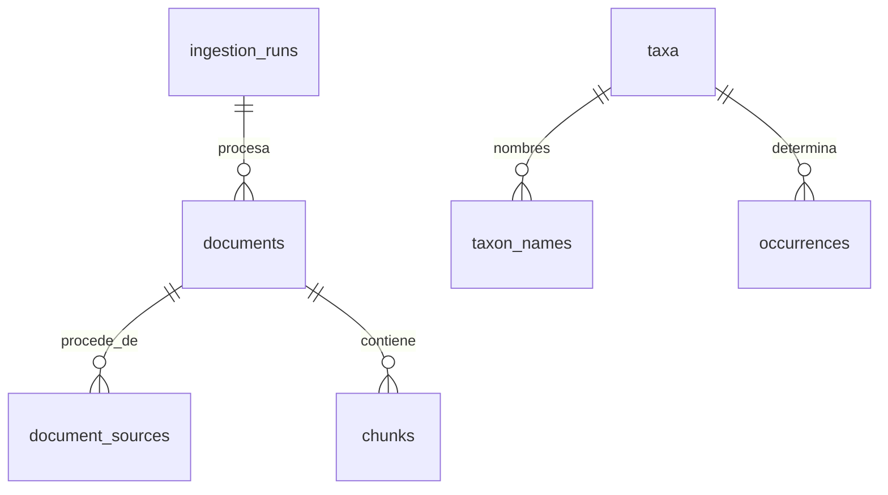

# Fase 0 · Polylepis, estación local de investigación

## Alcance acordado

Aplicación, PostgreSQL, documentos y embeddings en la laptop. Internet para OpenAlex, Crossref, GBIF, fuentes de texto autorizadas, teselas cartográficas y Claude. No alojamiento ni publicación. Solo fases 0 y 1. Sin cuentas de lectores, programación periódica, extracción de localidades, fichas generadas o administración editorial avanzada.

## Decisiones

| Decisión | Alternativa | Ventaja / costo / riesgo |
| --- | --- | --- |
| Next.js + FastAPI | Un solo servidor Python | Mantiene la arquitectura solicitada y separa UI de ciencia de datos; dos procesos locales. |
| PostgreSQL + PostGIS + pgvector | SQLite | Geometrías y búsqueda vectorial con migración futura sencilla; requiere Docker y más RAM. |
| FastEmbed multilingüe en CPU | Servicio externo de embeddings | Fragmentos y vectores permanecen locales; descarga inicial del modelo y latencia en CPU. |
| BM25 + vectores y fusión RRF | Solo búsqueda textual | Recuperación bilingüe; no equivale a garantizar pertinencia. Reranker neuronal diferido hasta evaluación de hardware/calidad. |
| Claude con citas nativas y validación local | Generación libre con referencias escritas por el modelo | Permite comprobar fragmentos e índices; necesita clave y tiene costo por uso. La validación no prueba por sí sola implicación semántica. |
| Ingesta manual repetible | Cron/Celery | Control de costo y depuración del MVP; actualización automática pertenece a fase 4. |

## Modelo y diccionario

Todos los tiempos son UTC. Identificadores externos se conservan como texto; no se inventan DOIs. `null` significa desconocido, nunca cero.

| Entidad | Campos principales | Reglas |
| --- | --- | --- |
| schema_migrations | version, applied_at | Migraciones versionadas e idempotentes. |
| taxa | gbif_key, scientific_name, canonical_name, status, accepted_key, rank, source_url, retrieved_at | Instantánea GBIF; POWO es referencia para contraste, no autoridad falsamente consultada. |
| taxon_names | name, taxon_key, kind, source_url | Sinónimos procedentes de GBIF. Nombres comunes solo si existe fuente. |
| documents | id, doi, title, normalized_title, year, authors, language, journal, abstract, license, license_evidence, pdf_url, text_status | DOI normalizado único; título+año solo fusionan cuando no existen DOIs contradictorios. Resumen únicamente si tiene licencia verificada. |
| document_sources | source, external_id, document_id, url, retrieved_at | Clave externa única. No se guarda respuesta cruda con texto restringido. |
| chunks | id, document_id, page, locator, text, content_hash, embedding, embedding_model | Texto de la versión licenciada. Página física PDF desde 1, o localizador «Resumen» sin inventar página. |
| occurrences | gbif_id, taxon_key, original_name, accepted_name, country, locality, geom, uncertainty_m, issues, license, dataset_key, source_url, collected_year, retrieved_at | WGS84; presencia; sin geocodificación. La existencia de coordenadas no implica verificación independiente. |
| ingestion_runs | id, source, status, started_at, finished_at, counts, error | Cada ejecución trazable, parciales y errores visibles. Reinicios marcan las ejecuciones interrumpidas. |
| gbif_downloads | download_key, doi, status, predicate, source_url | DOI real obtenido mediante descarga autenticada; consultas de exploración se etiquetan sin DOI de descarga. |
| query_audit | id, created_at, status, model, input_tokens, output_tokens, latency_ms, citation_count | Sin guardar conversaciones ni claves por defecto. Tokens reales; costo monetario no calculado sin tarifa configurada. |

El último vínculo describe el proceso; no es una FK: un documento puede ser procesado por múltiples ejecuciones. Las afirmaciones taxonómicas pueden cambiar; siempre se muestra la fuente y fecha. Las discrepancias POWO/GBIF requieren revisión y no se resuelven silenciosamente. El MVP no declara una lista definitiva de especies.

## Catálogo de fuentes

| Fuente | Uso en fase 1 | Permisos y límites |
| --- | --- | --- |
| [OpenAlex](https://help.openalex.org/api/) | Descubrimiento por género, metadatos, localizaciones y licencias | Clave para paginación por cursor; respetar 429/Retry-After. OA no significa licencia de reutilización. |
| [Crossref](https://www.crossref.org/documentation/retrieve-metadata/rest-api/) | Metadatos y DOI; búsqueda por título | Identificación con correo si se configura. No almacenar resúmenes sin autorización. |
| [GBIF](https://techdocs.gbif.org/en/openapi/) | Backbone, sinónimos y ocurrencias | Conservar licencia, dataset, registro e incidencias. Consulta exploratoria no genera DOI de descarga. |
| [GBIF Downloads](https://techdocs.gbif.org/en/data-use/api-downloads) | Descarga citable opcional con credenciales | Solicitud y consulta de estado; DOI solo cuando GBIF lo entrega. |
| [POWO](https://powo.science.kew.org/) | Referencia para contraste taxonómico documentado | Sin scraping masivo ni API supuesta. Contraste editorial pendiente y explícito. |
| Editorial / repositorio abierto | PDF enlazado por localización con licencia verificada | Respetar robots, HTTPS, tamaño máximo y licencia de esa versión. Fallos no habilitan scraping alternativo. |

Solo CC0, CC BY y CC BY-SA explícitas se habilitan inicialmente para texto; otras licencias se conservan como metadatos para revisión futura. No se incorporan figuras en fase 1. No se asumen derechos de una versión sobre otra.

## Calidad y aceptación

- No DOIs, especies, registros ni cifras de cobertura inventados. Datos sintéticos exclusivamente en pruebas identificadas.
- Ingesta repetida conserva conteos de documentos/identificadores; versiones y procedencias permanecen trazables.
- RAG: solo fragmentos autorizados. Los documentos son datos, nunca instrucciones. Citas nativas con comprobación de índices, rango y texto; respuesta bloqueada si quedan segmentos sustantivos sin citas.
- Una cita sintácticamente válida no demuestra fidelidad: revisión humana de 20 preguntas antes de considerar validado el asistente; 100 preguntas en fase posterior.
- No evidencia: abstención explícita. Sin clave: estado de configuración, nunca una respuesta simulada.
- Cobertura bibliográfica global y error geográfico: no medidos hasta disponer de universo de referencia y muestra revisada.
- Geocodificación de literatura: no aplica a fase 1. No presentar 0 % como medición.

## Seguridad local

Servicios enlazados exclusivamente a loopback; PostgreSQL en puerto 54329. Claves solo en `.env` ignorado. Validación de origen y Host para mutaciones, entradas limitadas, SQL parametrizado, redirecciones PDF validadas y sin ejecución de documentos. No abrir puertos al router. OneDrive puede sincronizar la carpeta del proyecto: los datos de Docker se guardan en volúmenes locales; si se usa modo nativo, elegir DATA_DIR fuera de carpetas sincronizadas cuando sea necesario.
